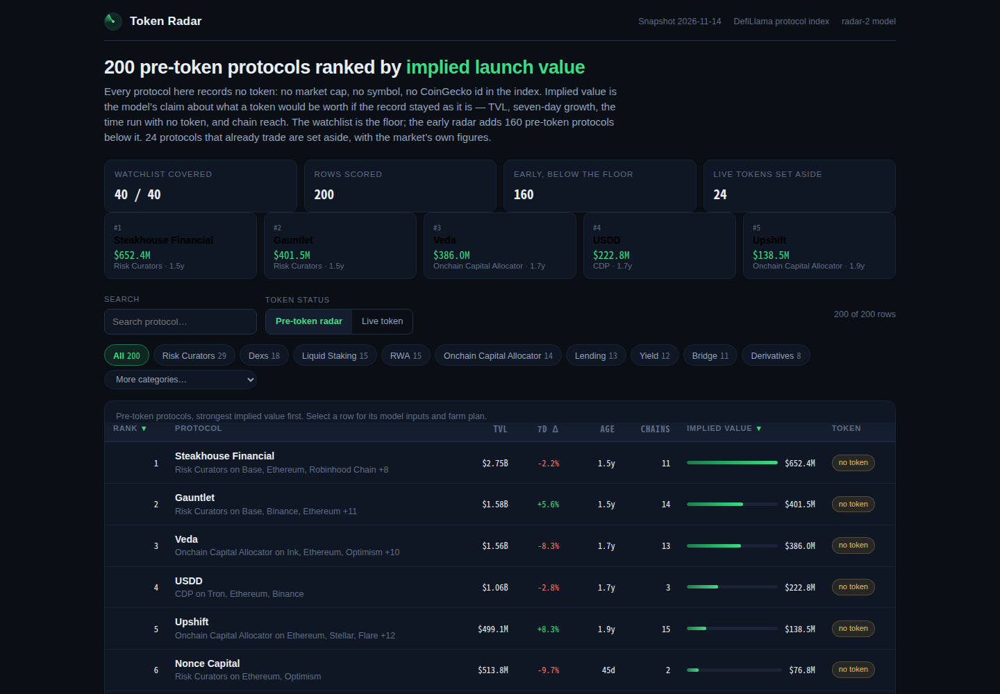
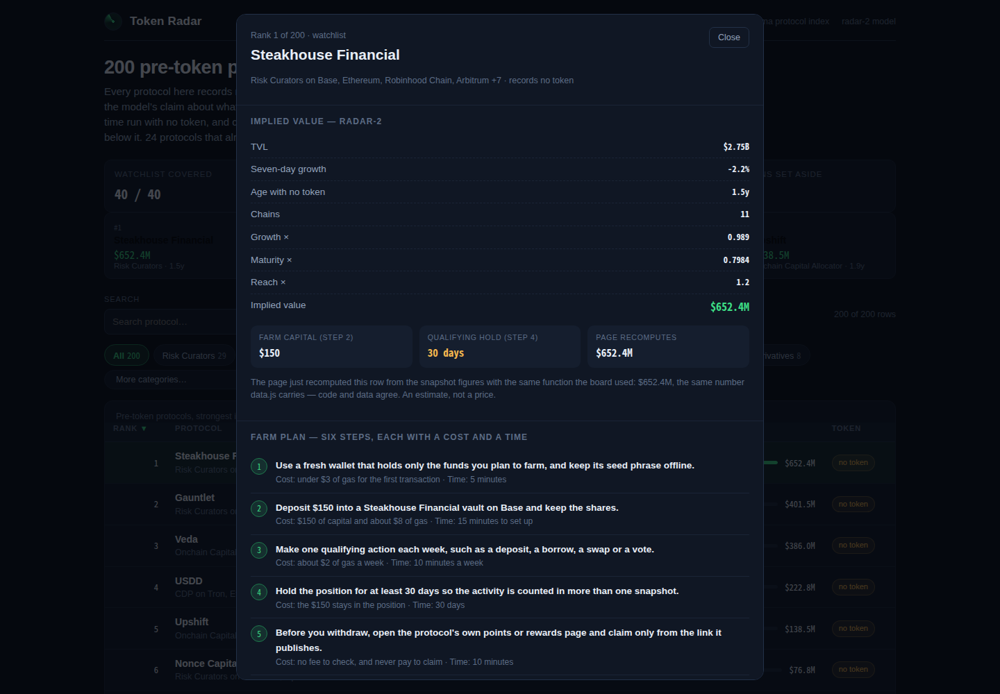
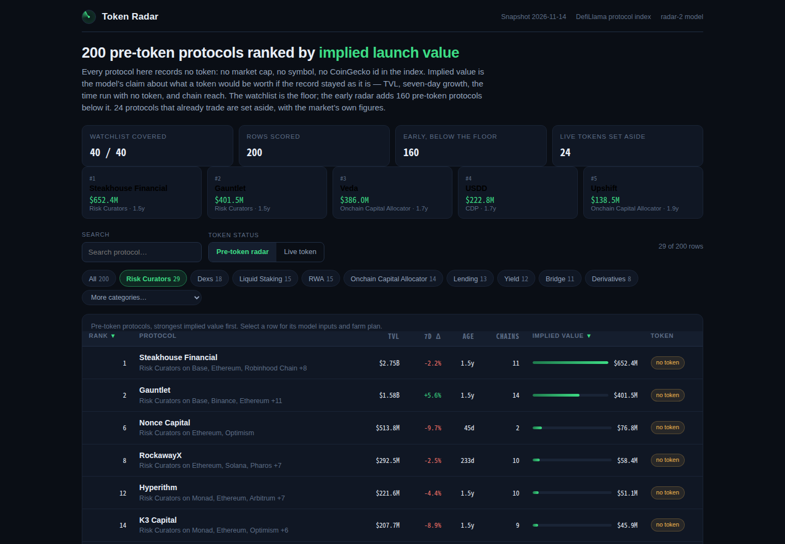

# Token Radar — 200 pre-token protocols ranked by implied launch value

> [!NOTE]
> **make.fun entry** — [token-radar-01](https://make.fun/c/token-radar-01)
> "Which pre-token protocol is worth farming next, and what do I do about it?"

## The entry

A Node 22 program (`main.ts`, stdlib only) reads the sealed DefiLlama
snapshot (758 protocols), scores **200 rows** — the 40-protocol watchlist
plus the 160 pre-token protocols below the floor with the most TVL — and
writes a dark, single-page dashboard:

- **radar-2 value model**: implied launch value from TVL, 7-day growth,
  days without a token (age penalty), chain reach (multi-chain bonus) and
  category base. No token, no market cap — a model claim, shown as such.
- **The board**: rank, protocol, TVL, 7-day Δ, age, chains, implied value
  bar, token status. Search, category chips, top-5 cards, stats strip.
- **Detail dialog per row**: the implied-value equation with every
  multiplier, the farm capital a retail position needs, the qualifying
  hold, and a 6-step farm plan written for that protocol's age, chain and
  TVL position.
- **Live-token tab**: the 24 protocols that already trade, set aside with
  their TVL — the radar explicitly does not rank them.

`node main.ts --input input/snapshot.json` (with `MAKEFUN_OUTPUT_DIR`
set) writes `board.json`, `data.js`, the dashboard (3 files, ~38 KiB, no
network) and 3 deterministic screenshots. Two runs, same bytes.

## Screenshots

| Board | Detail | Category filter |
|---|---|---|
|  |  |  |

## Verification

- Two consecutive runs in fresh directories produced **byte-identical**
  outputs (same sha256 for `board.json`, `data.js`, dashboard files).
- 200 rows, ranks 1..200, implied values monotonic non-increasing, all
  watchlist slugs covered, every farm plan 3–12 steps of 20–600 chars.
- Dashboard ships no network access: no `http(s)://` in attributes,
  styles, imports or requires.

## License

MIT — see [LICENSE](LICENSE).
